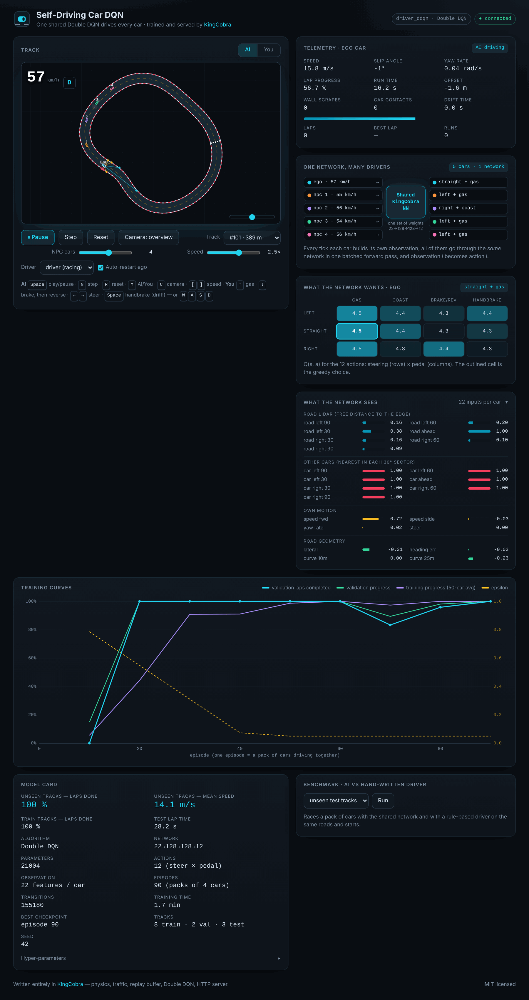

  

All notable changes are listed here. The format follows [Keep a Changelog](https://keepachangelog.com/), and the project uses
[semantic versioning](https://semver.org/).

##  1.0.0

First release.

  

###  Agent
* **One shared Double DQN drives every car** (parameter sharing): each car has its own observation and action, the observations
  go through the network in one batched forward pass, and all transitions feed one replay buffer.
* 12 actions (steer × pedal), 3-step returns, Huber loss, gradient clipping, soft target updates, linear LR decay.
* 22-number observation: 7-ray road lidar, a 7-sector car radar, own motion (forward / sideways speed, yaw rate, steering),
  lateral offset, heading error and curvature ahead.
* Training on 8 tracks, checkpoint selection on 2 validation tracks, final evaluation on 3 unseen test tracks.
* An optional `reward.drift` bonus and `train.select = last` for style models; a `drifter_ddqn` model ships next to `driver_ddqn`.
* A hand-written rule-based driver (`eval --baseline`) as a comparison.

###  Simulator
* Dynamic bicycle car with a tyre friction circle: understeer, **handbrake drift** and a **reverse gear**.
* Soft walls (scrapes) and car-to-car collisions; finished NPCs respawn in the dashboard.
* Deterministic procedural roads with an occupancy grid for fast lidar.

###  Dashboard and server
* Top-down view with lidar, chase camera, tyre marks and smoke; drive it yourself (gas, brake/reverse, steer, handbrake).
* Live "one network, many drivers" panel, the 12-action Q grid, input inspector, telemetry, training curves, model card,
  and an AI-vs-baseline benchmark. Switch the driver model per session.
* Per-session worlds, strict security headers, validated input, opt-in shutdown, structured request log.

###  Project
* Modular `src/`, JSON config with validation and `--set` overrides, CLI (`train eval serve info`).
* 67 KingCobra tests, Node tests for the front-end, Makefile, CI workflow, documentation, SVG banners / icons / diagrams,
  real screenshots and a gameplay video.
