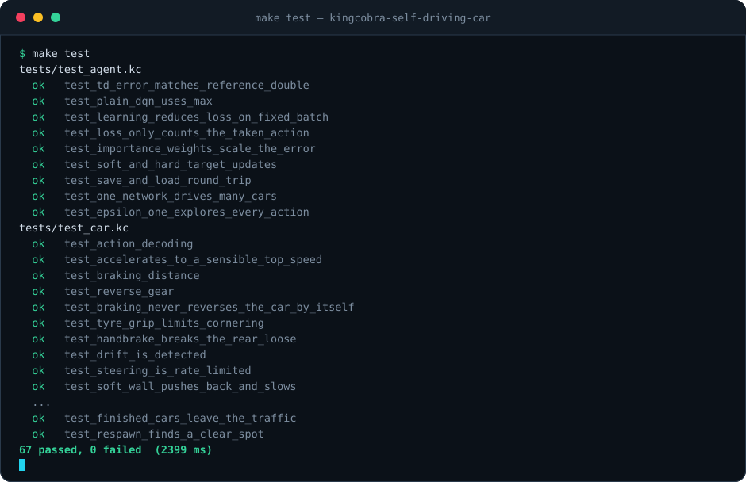
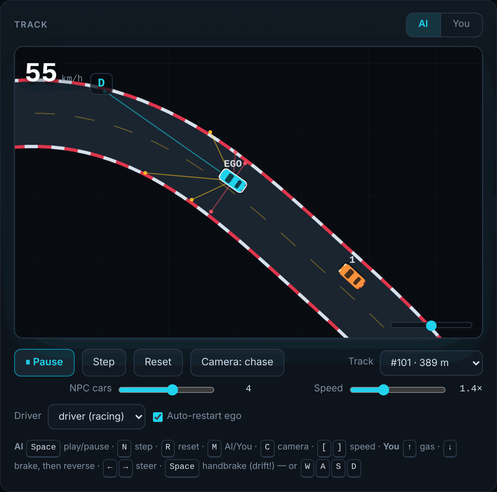

<p align="center">
  
</p>

Thanks for helping! The whole workflow fits on one screen.

<p align="center"></p>

##  Set up

1. Install KingCobra 1.0 (`kingcobra` on your `PATH`) and, for the front-end tests, Node.js 18+.
2. Clone the repo and run `make serve` to confirm everything works with the bundled models.

##  Before you open a pull request

`make check` (parse + type-check) and `make test` must pass.

<p align="center">
  
</p>

##  Ground rules

* **Keep modules stateless.** In KingCobra each `import` makes its own module instance, so pass state (cars, worlds, agents,
  replay buffers) as objects — see [`docs/ARCHITECTURE.md`](docs/ARCHITECTURE.md).
* **No closures on the request path.** The server avoids `fn(...)` closures because they have crashed the interpreter on Windows;
  use plain loops there.
* **Physics changes need a test** in `tests/test_car.kc` that states what real behaviour you expect (stopping distance, grip limit, …).
  Changing a constant in `car.kc` changes how every model drives — retrain.
* **Changed the observation, the actions, the physics or the reward?** Retrain the shipped models (`make train`, and the drifter,
  see the README) and update the numbers in `README.md` and `docs/TRAINING.md`. Old models are incompatible with a new input size.
* **Training must stay deterministic.** All randomness goes through `util.rnd()` / `util.below()` (one generator); tracks have
  their own deterministic generator. `tests/test_trainer.kc` fails if two runs with the same seed differ.
* **Style:** 4-space indent in KingCobra, 2 in web files (`.editorconfig`), doc comments (`///`) on public functions.

##  Working on the simulator

```sh
kingcobra run src/main.kc eval --starts 3             # does it still drive?
kingcobra run src/main.kc eval --baseline --starts 3  # and how does the rule-based driver compare?
```

The quickest way to *see* a physics change is the dashboard: `make serve`, press `C` for the chase camera, `M` to take the wheel,
`Space` for the handbrake.

##  Changing the look

The banners, icons, diagrams and terminal pictures in `docs/img/` are generated, so edit the generator rather than the SVGs:

```sh
make assets         # node scripts/build_assets.js  -> banners, icons, diagrams, results card, terminal shots
make screenshots    # needs: pip install playwright && playwright install chromium; run `make serve` first
make video          # same requirements plus ffmpeg; rewrites docs/media/gameplay.mp4 and docs/img/gameplay.gif
```

<p align="center">
  
</p>

If you change the UI, retake the screenshots and the video so the docs match what people will see.

##  Reporting bugs

Please include the command you ran, `--seed`, your OS, and the output of `kingcobra run src/main.kc info`. For dashboard
problems, the browser console output helps most.
