<p align="center">
  
</p>

<p align="center">
  <a href="#quick-start"> Quick start</a> &nbsp;·&nbsp;
  <a href="#one-network-many-drivers"> Shared network</a> &nbsp;·&nbsp;
  <a href="#car-physics-drift-and-reverse"> Physics</a> &nbsp;·&nbsp;
  <a href="#the-dashboard"> Dashboard</a> &nbsp;·&nbsp;
  <a href="#training"> Training</a> &nbsp;·&nbsp;
  <a href="docs/API.md"> API</a> &nbsp;·&nbsp;
  <a href="CONTRIBUTING.md"> Contributing</a> &nbsp;·&nbsp;
  <a href="CHANGELOG.md"> Changelog</a>
</p>

<p align="center">
  
</p>

Self-driving cars that learn by **deep Q-learning**, written in [KingCobra](https://github.com/DivyanshuSinha136/KingCobra) with
nothing but its standard library (`std.nn`, `std.http`, `std.json`, `std.system`). Every car on the road — the one you watch
and all the NPC traffic around it — is driven by the **same neural network**: each car builds its own observation, the whole
set goes through the shared network in one batched pass, and observation *i* becomes action *i*. The cars have a proper
dynamic **tyre model with drift (handbrake) and a reverse gear**.

<p align="center">
  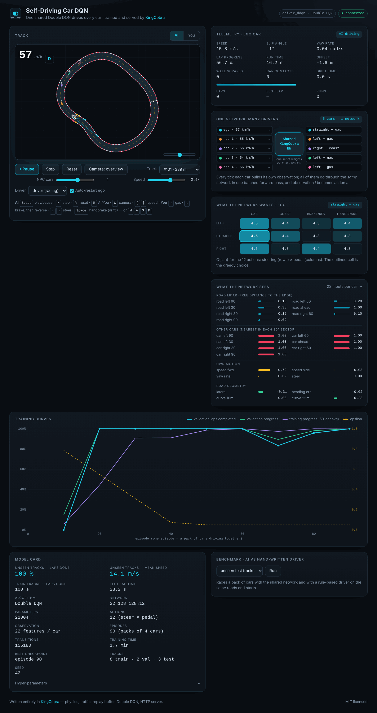
  <br><sub>The dashboard, captured from the real app: the AI and four NPC cars on an <em>unseen</em> test track, all driven by one network.</sub>
</p>

| | |
|---|---|
| **Result** | **100 %** of laps completed on 3 tracks the network never saw, at 14 m/s, with no wrecks — after a 1.7-minute CPU training run |
| **Agent** | one shared Double DQN · 3-step returns · Huber loss · gradient clipping · soft target updates · 12 actions (steer × pedal) |
| **Physics** | dynamic bicycle model, tyre friction circle, **handbrake drift**, **reverse gear**, soft walls, car-to-car collisions |
| **Observation** | 22 numbers per car: 7-ray lidar, a 7-sector car radar, own motion (incl. sideways slip and yaw), the road ahead |
| **Dashboard** | top-down view with lidar, chase camera, drive it yourself, per-car actions, Q-grid, training curves, AI-vs-baseline benchmark |
| **Reproducible** | one seed controls everything; two runs with the same seed give bit-identical models |

<p align="center"></p>

##  Watch it drive

<p align="center">
  <a href="docs/media/gameplay.mp4">
    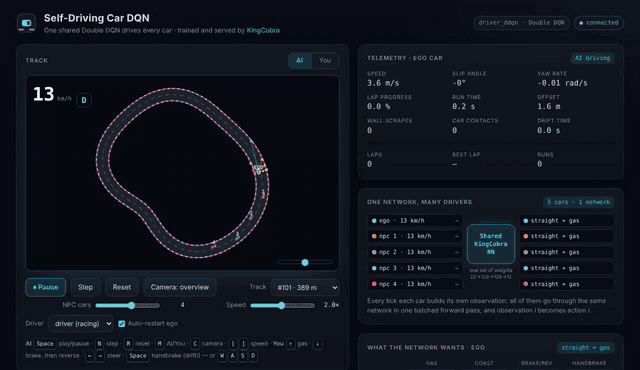
  </a>
  <br><sub>47 seconds recorded from the real dashboard: AI traffic on an unseen track → chase camera → the <em>drifter</em> model →
  a human adds a handbrake drift and reverses → the AI takes back over. <a href="docs/media/gameplay.mp4">Full-quality MP4</a> (3 MB).</sub>
</p>

<p align="center"></p>

##  Quick start

Requires KingCobra 1.0 (`kingcobra` on your `PATH`) — and `node` only for the front-end tests.

```sh
git clone https://github.com/DivyanshuSinha136/kingcobra-self-driving-car
cd kingcobra-self-driving-car

make serve            # open http://127.0.0.1:8766 — two pre-trained models are included
make eval             # laps on seen and unseen tracks, with traffic
make train            # retrain from scratch (~2 minutes on one CPU core)
make test             # 67 KingCobra tests + front-end tests
```

No `make`? Every target is one command: `kingcobra run src/main.kc <command> [options]`.

<p align="center"></p>

##  Commands

```
kingcobra run src/main.kc <command> [options]

train    train an agent; writes <out>/<name>.kcnn, .json (model card) and .metrics.json (curves)
eval     drive greedy laps on seen and unseen tracks and print statistics   (--baseline: the rule-based driver)
serve    serve the web dashboard (trains first if no model exists)
info     print the model card of the saved model

--config FILE     JSON file overriding config/default.json        --seed N      random seed
--set a.b=value   override any value (repeatable)                  --episodes N  training episodes
--out DIR --name NAME   where the model lives                      --port N --host H   server address
```

```sh
kingcobra run src/main.kc eval --starts 3                          # AI, 3 start positions per track
kingcobra run src/main.kc eval --baseline --starts 3               # the hand-written driver, same roads
kingcobra run src/main.kc train --name drifter_ddqn --set reward.drift=0.4 --set train.select=last
kingcobra run src/main.kc train --set sim.cars=6 --set sim.spacing=15 --episodes 120    # busier traffic
```

Every tunable is in [`config/default.json`](config/default.json) and documented in [`docs/TRAINING.md`](docs/TRAINING.md). Unknown
keys and nonsensical values are rejected with a clear message.

<p align="center"></p>

##  One network, many drivers

<p align="center">
  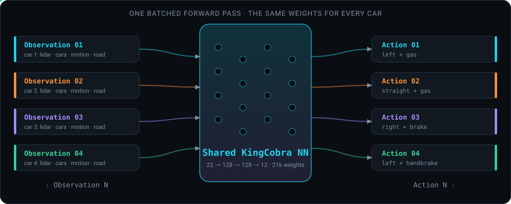
</p>

```
                    Shared KingCobra NN      (one set of weights)
                           |
                           +--- Observation 01 -> Action 01      car 1
                           +--- Observation 02 -> Action 02      car 2
                           +--- Observation 03 -> Action 03      car 3
                           +--- Observation N  -> Action N       car N
```

This is **parameter sharing**, the standard way to train many identical agents:

* **One brain, N bodies.** Each car senses *its own* world (its lidar, its neighbours, its own slip) and gets *its own* action, but
  the weights are shared, so everything any car learns helps all of them.
* **One batched forward pass per tick.** The observations of every running car are stacked and sent through the network together
  (`agent.q_values_batch`), which is much cheaper than one pass per car. A test checks that the batch gives exactly the per-car answers.
* **One replay buffer.** Every car's transitions go into the same buffer, so a 4-car pack produces 4× the experience per tick.
* **At serving time too.** In the dashboard the NPCs and (in AI mode) the ego car are the same network; take the wheel and *you*
  replace only the ego car's action — the NPCs keep using the network.

The panel in the dashboard shows this live: one row per car, the observation going in and the action coming out.

<p align="center">
  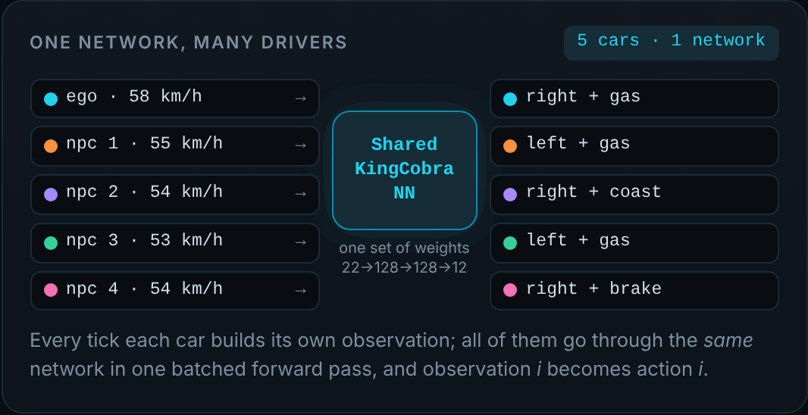
</p>

<p align="center"></p>

##  Car physics: drift and reverse

Each car is a **dynamic bicycle model** (mass, inertia, two axles, four 25 ms sub-steps per 0.1 s tick), not a point on rails. Tyre lateral force
is linear in the slip angle until it saturates at `μ·load`, and it shares that budget with the longitudinal force (a *friction
circle*). The consequences are the ones you expect from a real car:

* **Understeer** — brake or accelerate hard in a bend and the front tyres run out of grip.
* **Drift** — the **handbrake** locks the rear wheels (a small friction budget), the rear lets go, and the car rotates and slides.
  The dashboard flags it (`DRIFT`, slip angle in the telemetry) and leaves tyre marks and smoke.
* **Reverse** — the "brake / reverse" pedal brakes while moving forward and, once stopped, drives the car backwards
  (up to 6 m/s). The cars can really back out of trouble.
* **Soft walls** — touching the road edge pushes the car back and scrubs speed (a *scrape*) instead of ending the run;
  too many scrapes wreck it.

<p align="center">
  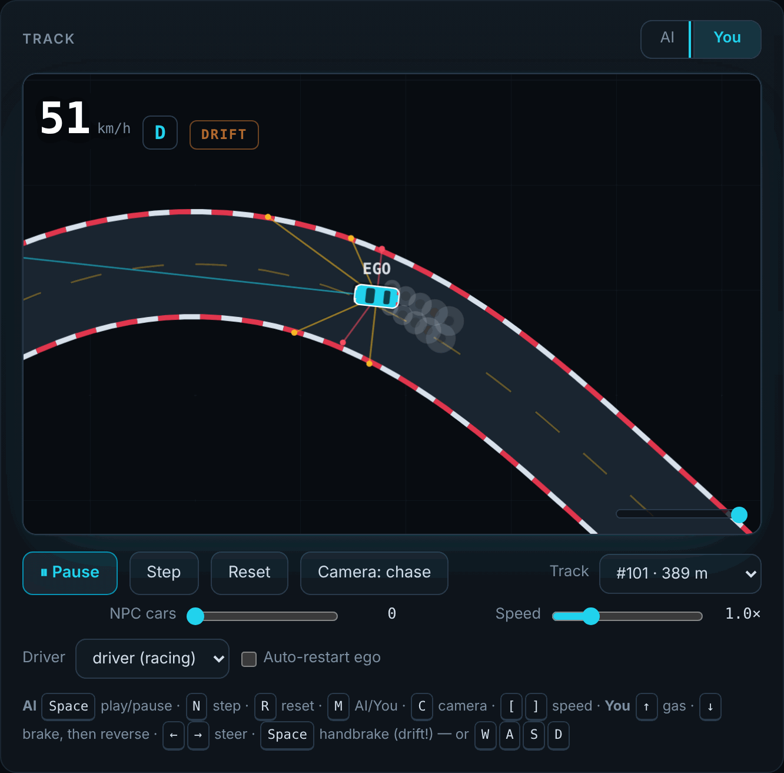
  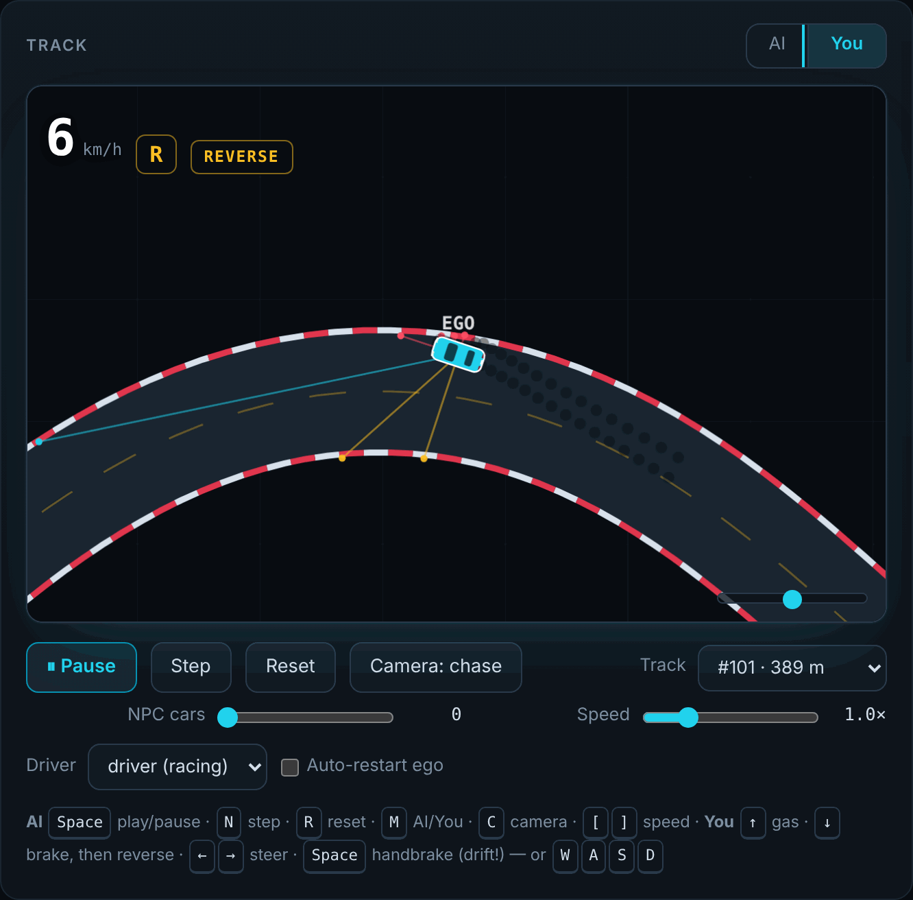
</p>

Full model, parameters and equations: [`docs/PHYSICS.md`](docs/PHYSICS.md).

### Racer and drifter

Two networks ship, trained with the same code — only the reward differs (`reward.drift`):

| | `driver_ddqn` (racing) | `drifter_ddqn` (drift) | rule-based driver |
|---|---|---|---|
| laps completed, unseen tracks | **100 %** | **100 %** | 92 % |
| laps completed, training tracks | **100 %** | 98 % | 88 % |
| mean speed, unseen tracks | 13.9 m/s | 7.5 m/s | 13.2 m/s |
| mean lap time, unseen tracks | **28.4 s** | 52.9 s | 29.9 s |
| time spent drifting | 0.4 % | **53.7 %** | 2.2 % |
| car contacts per run (unseen) | **0.00** | **0.00** | 1.11 |
| wall scrapes per run (unseen) | **0.4** | 0.3 | 1.2 |

Numbers are from `make eval` (3 start positions per track, 4 cars on the road; the rule-based driver is blind to the handbrake and
reverse). Honest reading: the racer is the fastest *and* the most reliable; the drifter is a style model that trades a lot of
speed for sliding — it learns to drift because the bonus pays, so treat it as a demonstration, not as a better driver. Pick the
driver in the dashboard (`Driver` menu) or with `--name`.

<p align="center">
  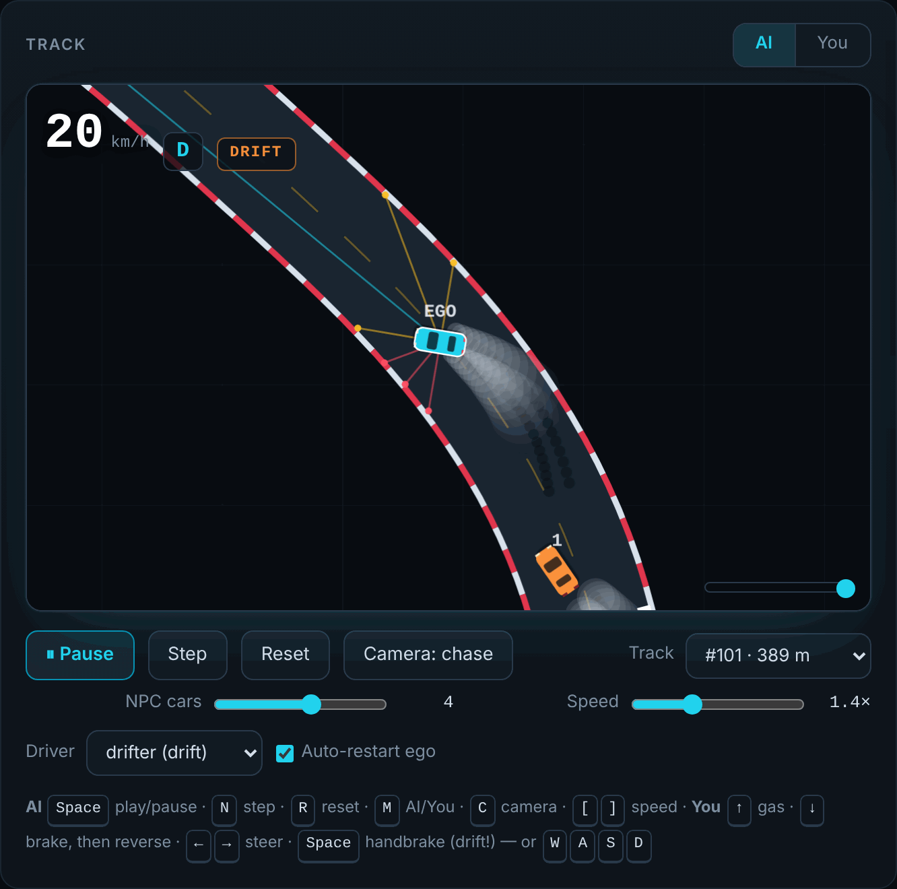
</p>

<p align="center"></p>

##  The dashboard

Keyboard: `Space` play/pause · `N` step · `R` reset · `M` AI/You · `C` camera · `[` `]` speed. **You** drive the cyan car:
`↑`/`W` gas · `↓`/`S` brake, then reverse · `←` `→` / `A` `D` steer · `Space` handbrake. Pressing a driving key takes the wheel.

<table>
<tr>
<td width="50%" valign="top">
  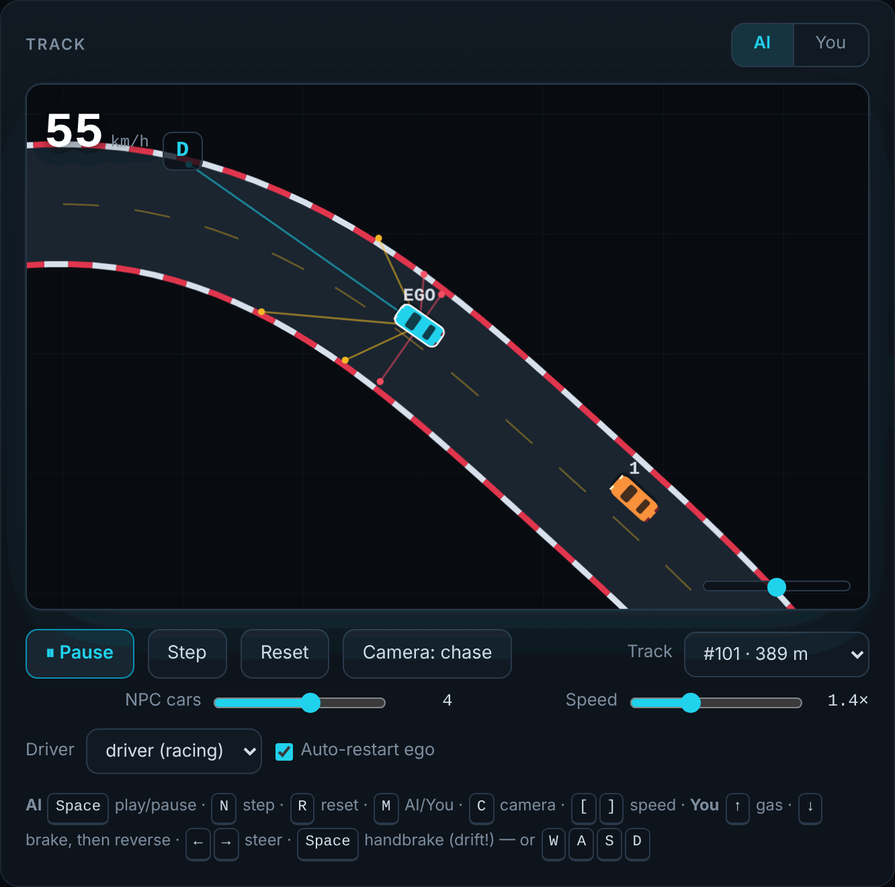
  <br><sub><b>Chase camera</b> with the ego car's lidar (cyan/amber/red by distance) and NPCs.</sub>
</td>
<td width="50%" valign="top">
  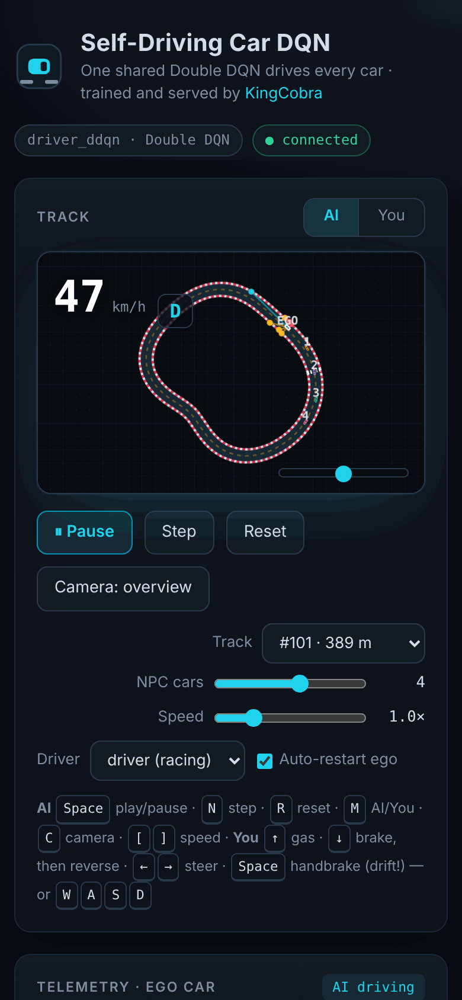
  <br><sub><b>Responsive.</b> Works on a phone.</sub>
</td>
</tr>
<tr>
<td width="50%" valign="top">
  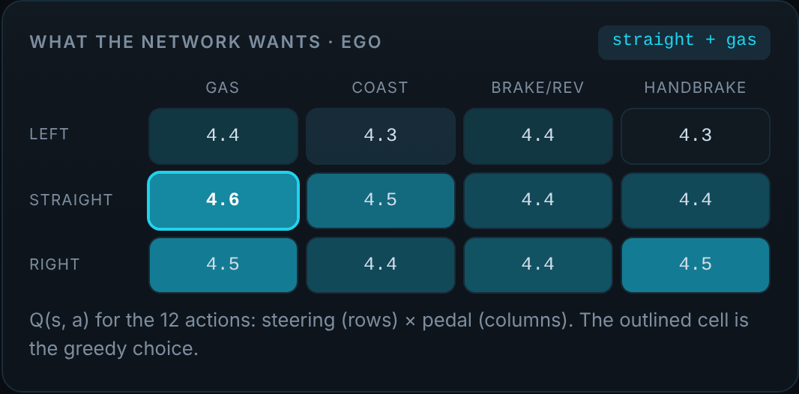
  <br><sub><b>What the network wants:</b> Q(s, a) for all 12 actions (steer × pedal).</sub>
</td>
<td width="50%" valign="top">
  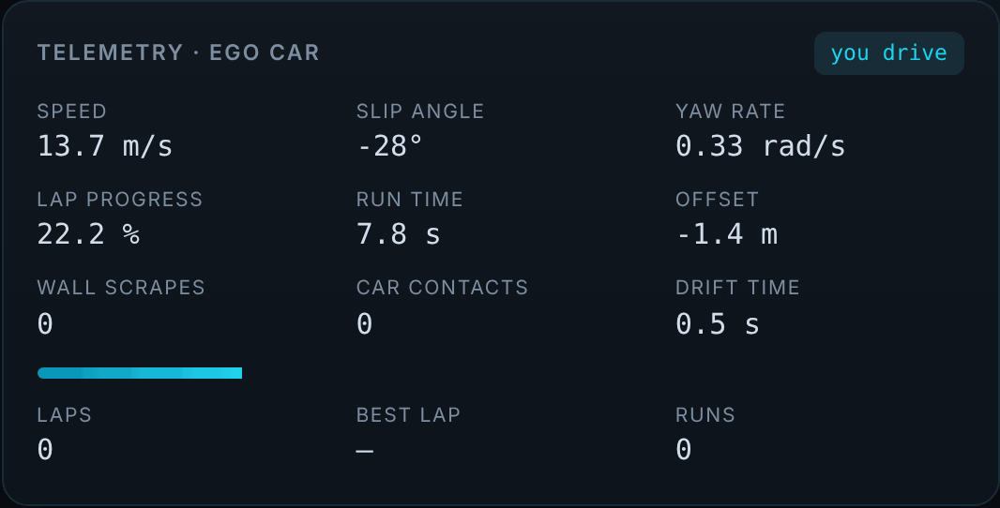
  <br><sub><b>Telemetry</b>: speed, slip angle, yaw rate, scrapes, contacts, drift time.</sub>
</td>
</tr>
</table>

<p align="center">
  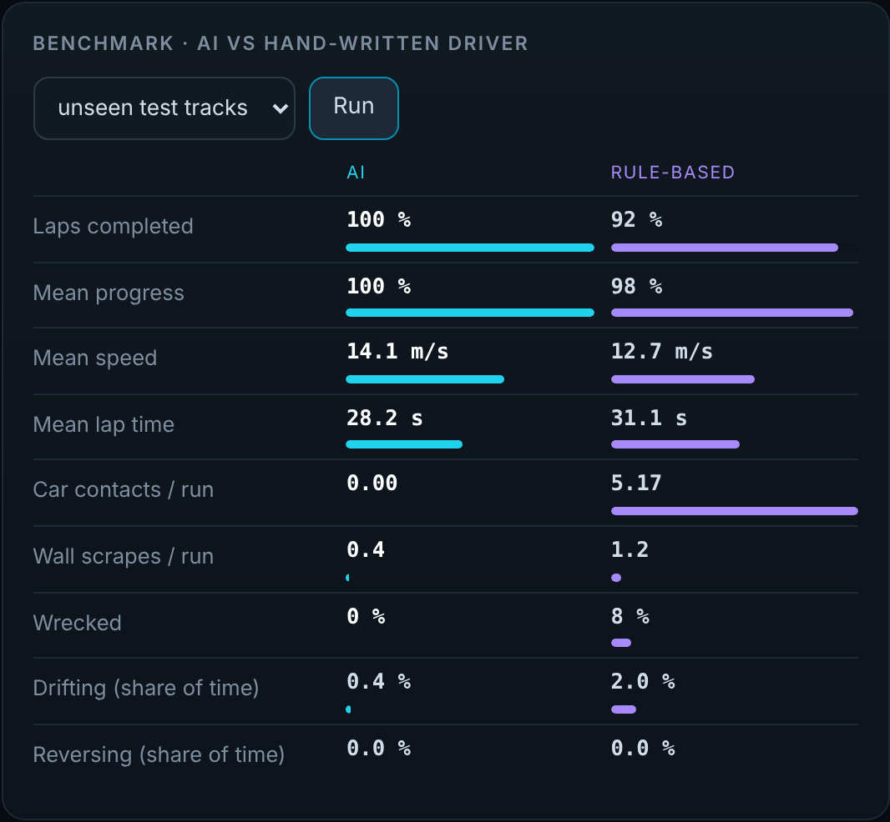
  <br><sub>The built-in benchmark races the network against the rule-based driver on the same roads and starts (2 starts per track here, so
  its numbers differ a little from the 3-start table above).</sub>
</p>

<p align="center"></p>

##  Training

<p align="center">
  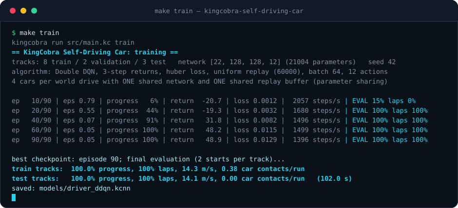
</p>

<p align="center">
  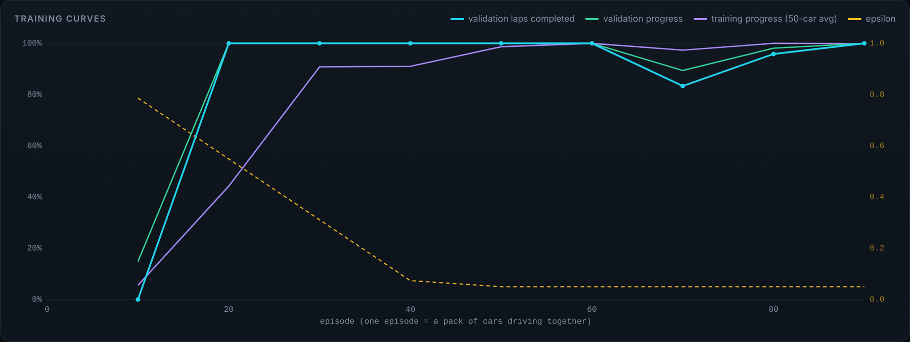
</p>

An *episode* is a pack of 4 cars driving together on a random training track from random start positions. The **checkpoint is chosen on
separate validation tracks**, and the final numbers are measured on **test tracks that were never used for training or for any
decision**. Details, rewards and hyper-parameters: [`docs/TRAINING.md`](docs/TRAINING.md).

<p align="center">
  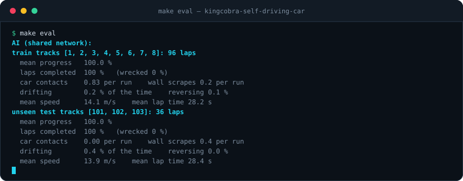
</p>

<p align="center"></p>

##  How it works

<p align="center">
  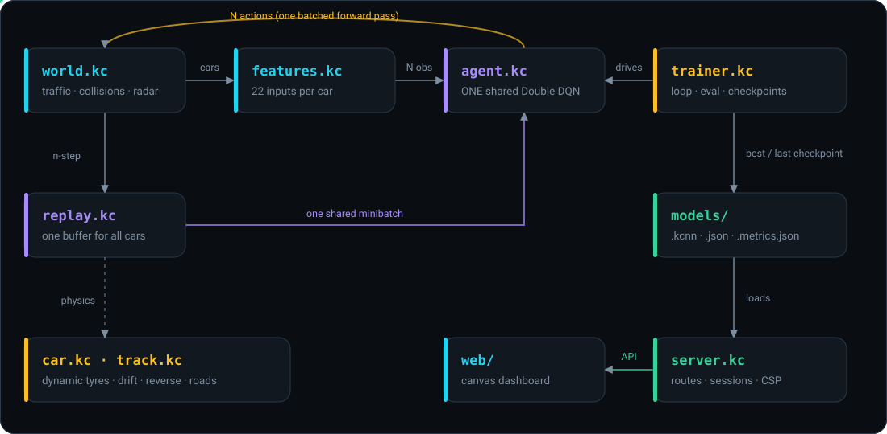
</p>

**Observation (22 numbers per car).** 7 lidar rays to the road edge; a 7-sector radar giving the distance to the nearest *other car*
in each 30° sector (thin rays would miss a neighbour a few metres to the side); forward speed, **sideways speed and yaw rate** (so the
network can feel a slide), steering angle; lateral offset, heading error and the road's curvature 10 m and 25 m ahead.

**Actions (12).** Steering {left, straight, right} × pedal {gas, coast, brake/reverse, handbrake}. Steering is rate-limited, so the car
cannot snap between full locks.

**Reward.** Progress along the centre line, a small time cost (so speed matters), small lateral-offset cost, penalties for wall
scrapes (−0.4) and car contacts (−1), a bonus for finishing a lap (+20), and an optional drift bonus. Runs end on a lap, on being stuck,
going the wrong way, wrecking (14 scrapes) or a time limit.

<p align="center"></p>

##  Project layout

```
src/
  main.kc        CLI (train · eval · serve · info)
  config.kc      defaults, JSON overlay, --set overrides, validation
  track.kc       procedural roads + occupancy grid for fast lidar
  car.kc         dynamic car: tyres, drift, reverse, soft walls, road lidar
  world.kc       several cars: collisions, car radar, rewards, respawn
  features.kc    the 22-number observation of one car
  replay.kc      one circular buffer for all cars (optional prioritised sampling)
  agent.kc       the shared Double DQN: batched inference, vectorised learning step
  trainer.kc     training loop, evaluation on seen / unseen tracks, checkpointing
  baseline.kc    the hand-written driver to compare against
  server.kc      routing, sessions, models, security headers, static assets
  util.kc        RNG, statistics, helpers
web/             index.html · style.css · app.js · favicon.svg
config/          default.json
models/          pre-trained driver_ddqn and drifter_ddqn (+ model cards and curves)
scripts/         build_assets.js (SVGs) · screenshots.py · record_video.py · test_web.sh
tests/           KingCobra tests (physics, world, features, agent, trainer, server, …) and tests/web/ (Node)
docs/            ARCHITECTURE.md · PHYSICS.md · TRAINING.md · API.md · img/ · media/
```

<p align="center"></p>

##  HTTP API

`GET /api/state` · `POST /api/reset` · `POST /api/ai-step` · `POST /api/drive` · `GET /api/models` · `GET /api/model` ·
`GET /api/metrics` · `GET /api/tracks` · `GET /api/track` · `GET /api/benchmark` · `GET /api/health`. Games are per session
(`?sid=`), and each session has its own cars and chosen model. Full reference: [`docs/API.md`](docs/API.md).

<p align="center"></p>

##  Testing

<p align="center">
  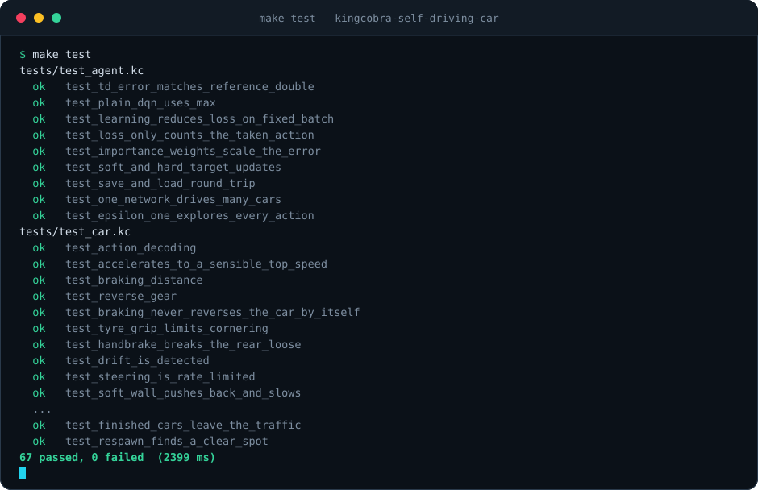
</p>

`make test` runs 67 KingCobra tests — track determinism and drivable bends, the physics (acceleration, braking distance, reverse, the
grip limit, the handbrake breaking the rear loose, soft walls), the multi-car world (collisions, car radar, end conditions,
respawn), the shared network (a batched pass equals per-car passes; observation *i* → action *i*), the Double-DQN target
against a reference, exact save/load round-trips, determinism of whole training runs, and the real server booted as a child
process and driven over HTTP — plus unit tests for the front-end's pure functions and a smoke test that runs the real `app.js`
against a live server with a stub DOM.

<p align="center"></p>

##  Limitations

* The simulator is 2-D and the roads are procedural loops; there are no junctions, traffic rules or pedestrians.
* The racer rarely drifts or reverses on its own — a racing reward gives it no reason to. Those abilities are used by the drifter
  (reward-shaped) and by human drivers.
* NPCs are the *same* network as the ego car, not independent policies; they cooperate by construction.
* The server is single-threaded; the benchmark request blocks other requests while it runs (capped at 6 starts per track).
* Training runs on the KingCobra interpreter on one CPU core (about 1,500 transitions per second, including learning).
* Results come from one seed; there are no multi-seed confidence intervals.

<p align="center"></p>

##  License

[MIT](LICENSE) © 2026 Divyanshu Sinha
