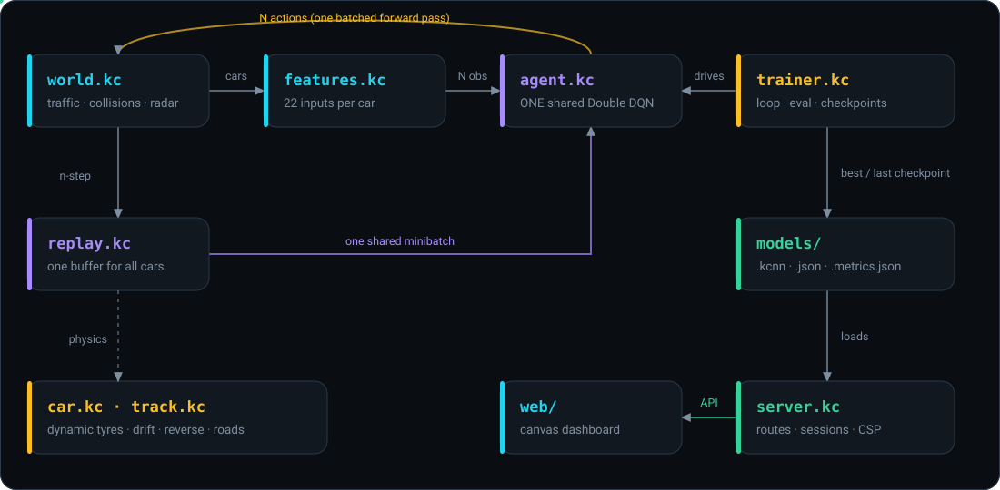
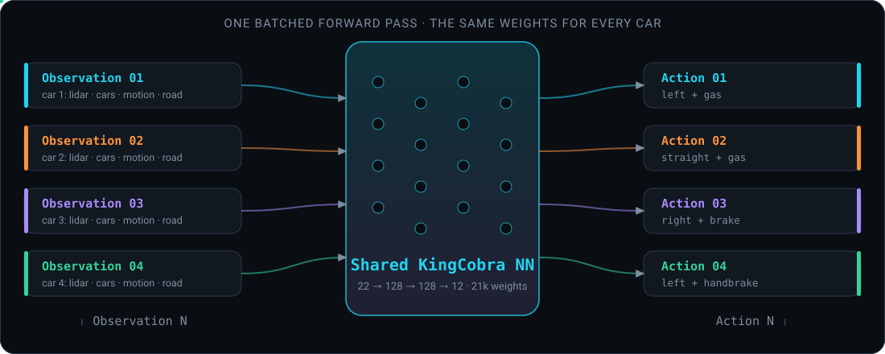

# Architecture

  

## Modules and responsibilities

| Module | Depends on | Responsibility |
|---|---|---|
| `util.kc` | `std.nn`, `std.system` | RNG through `nn`'s generator, statistics, formatting, `fail()` |
| `track.kc` | `util` | deterministic procedural roads, occupancy grid, nearest-point lookup, road outline for drawing |
| `car.kc` | `util`, `track` | one car: tyres, drift, reverse, soft walls, progress, road lidar |
| `world.kc` | `car`, `track` | several cars: collisions, the car radar, rewards and end conditions, respawn |
| `features.kc` | `car`, `track` | the 22-number observation of **one** car |
| `replay.kc` | `util` | ring buffer + sum tree; knows nothing about networks or cars |
| `agent.kc` | `util`, `std.nn` | the shared network: batched inference, vectorised Double-DQN update, save/load |
| `baseline.kc` | `features`, `car` | the hand-written driver |
| `trainer.kc` | all of the above | worlds, per-car n-step windows, evaluation on seen / unseen tracks, checkpoints, metrics |
| `config.kc` | `std.json`, `util` | defaults → JSON file → `--set`, validation |
| `server.kc` | `trainer`, `agent`, … | routing as a pure function, sessions, models, static assets |
| `main.kc` | everything | argument parsing and command dispatch |

The agent has no idea what a car is (it knows an input size and an action count), and the world has no idea a learner exists. That
separation is what lets the trainer, the evaluator, the baseline and the server all drive the same `world.step`.

## The shared network

  

* **Observation i → action i.** `features.encode(car)` is a function of *one* car, so every car — however many there are — produces
  the same kind of vector. `agent.q_values_batch(observations)` runs them all through the network at once; row *i* of the output
  belongs to car *i*. `trainer.choose_all` and `server.tick` both rely on this contract, and `tests/test_agent.kc` proves a batch
  equals the per-car answers.
* **One replay buffer.** `trainer.train` keeps one n-step window *per car* and pushes completed transitions into the single buffer.
* **A human replaces one action, not the network.** `server.tick(ctx, sess, ego_action)` overrides only the ego car's action; every
  NPC still comes from the batched pass.

## Design decisions

**Worlds are plain objects, modules are stateless.** In KingCobra every `import` of a file creates its own module instance, so a
module-level `var` is *not* shared between importers. All shared state (worlds, cars, agents, replay buffers, sessions) therefore
travels as objects passed explicitly. A side benefit: every function is trivially testable.

**One RNG.** Exploration, weight initialisation, replay sampling, start positions and respawns all draw from `nn`'s generator, so
`nn.seed(n)` reproduces a run exactly. Roads use their own tiny LCG so that "track 101" is the same road everywhere and generating
a road never disturbs the training stream.

**A radar, not more rays, for other cars.** A car 20 m away is only ~0.15 rad wide; seven thin rays would miss a neighbour a few metres
to the side. The car channel is therefore seven 30° *sectors* (nearest other car whose bearing falls in the sector), refreshed after
all cars have moved.

**Fast sensing.** The road is rasterised once per track into a 1 m occupancy grid, so a lidar ray is a few array lookups (2 m steps
plus bisection to refine the edge) instead of segment intersections.

**Soft walls.** Ending a run on first contact would make reversing pointless. Contact pushes the car back inside, scrubs speed and
counts a scrape; only repeated scrapes end the run.

**Routing is a function.** `server.route(ctx, req)` returns a response object; only `server.run` touches sockets.

**Atomic writes.** Metrics and model cards are written to a temp file and renamed, so a dashboard polling during training never
reads half a file.

## Extending

* **Other roads** — change `track.generate` (or add junction-free shapes); keep it deterministic per seed.
* **More actions** (e.g. analogue steering) — add them in `car.kc`, update `N_ACTIONS` / `ACTION_NAMES`, retrain.
* **New observation features** — add them in `features.kc`, update `NAMES` and `DIM`; the dashboard's inspector picks the names up
  from the model card. Old models are incompatible and must be retrained.
* **A different learner** — anything exposing `create / q_values_batch / act_batch / learn / save / load` with the same shapes can
  replace `agent.kc`.
