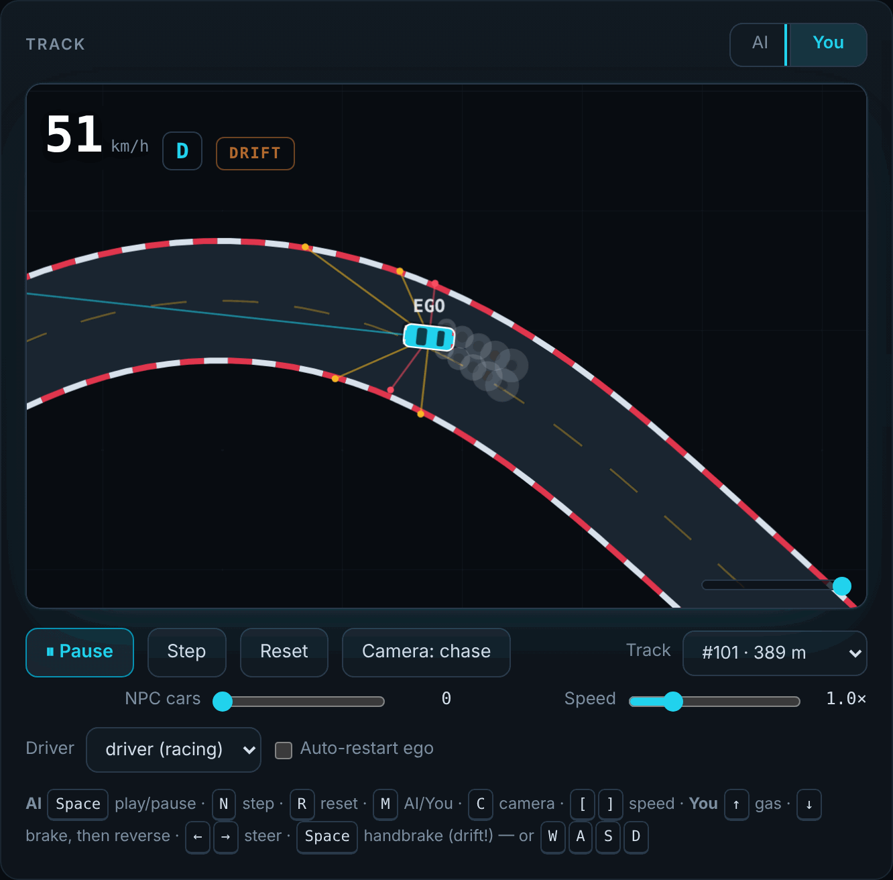
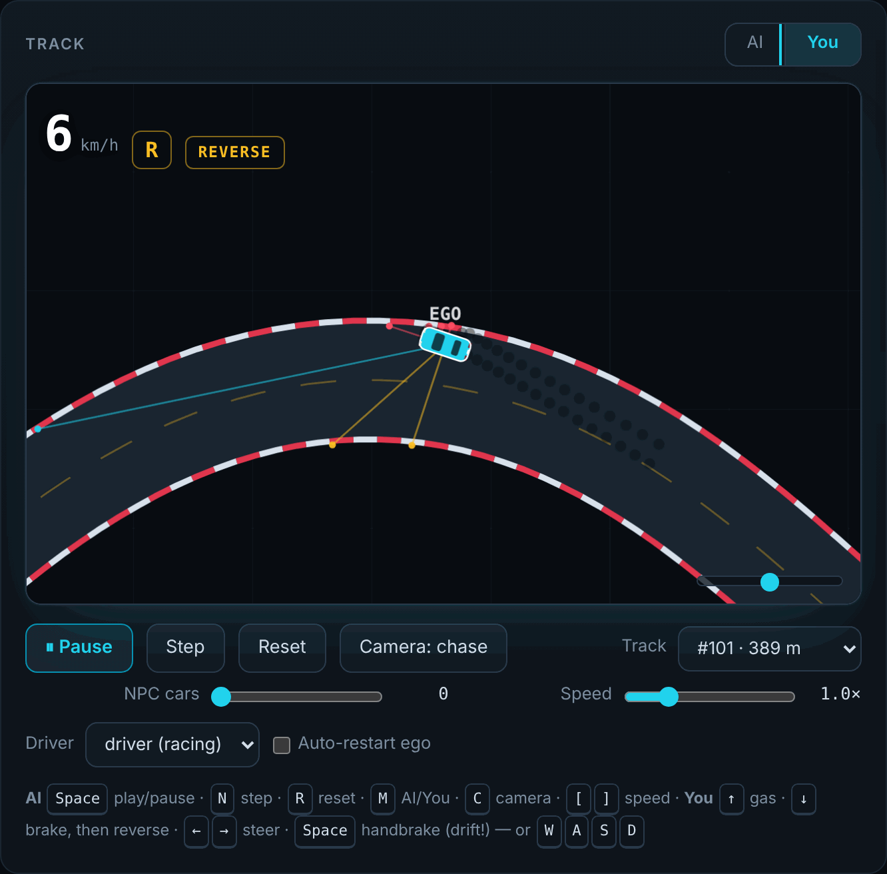

# Car physics

<p align="center">
  
  
</p>

Source: [`src/car.kc`](../src/car.kc). Units are metres, seconds and newtons; headings are counter-clockwise from +x. One
`step` is **0.1 s**, integrated as **4 sub-steps of 25 ms**.

## State

Pose `(x, y, θ)` and velocity in the car's **body frame**: `vx` forward (negative = reversing), `vy` sideways (left), and the yaw
rate `ω`. The steering angle `δ` is a separate state: it moves towards the commanded angle at most 2.2 rad/s, so the car cannot
snap between full locks.

## Tyres: a dynamic bicycle model

For each axle the slip angle is `α_f = atan((vy + a_f·ω) / |vx|) − δ` (front) and `α_r = atan((vy − a_r·ω) / |vx|)` (rear), with
`|vx|` floored at 1.2 m/s so the formula stays finite when nearly stopped. The raw lateral force is `−C·α` (linear) and is then
limited by a **friction circle**:

```
F_y,max = sqrt( (μ·N)² − F_x² )        N = static axle load,  F_x = this axle's longitudinal force
```

so an axle that is braking or driving hard has less grip left to corner with — that is understeer and, at the rear,
oversteer. The body-frame equations of motion are

```
dvx/dt = Fx/m + vy·ω          dvy/dt = Fy/m − vx·ω          dω/dt = (a_f·Fy_front − a_r·Fy_rear) / I
```

## Pedals

| Pedal | Effect |
|---|---|
| **gas** | all-wheel drive, force fading linearly to zero at `V_MAX` (22 m/s) |
| **coast** | only rolling resistance and drag |
| **brake / reverse** | while `vx > 0.6`: brakes, split 60 % front / 40 % rear; once (nearly) stopped: **reverse gear**, force fading to zero at 6 m/s backwards |
| **handbrake** | rear-only braking **and** the rear friction coefficient drops from 0.85 to 0.38: the rear tyres saturate first, the car rotates and slides — a **drift** |

Braking never pushes the car backwards by itself, and a nearly-stopped car does not creep sideways (static friction damping).

## Parameters

| Constant | Value | | Constant | Value |
|---|---|---|---|---|
| mass | 1200 kg | | engine (AWD, 50/50) | 5200 N |
| yaw inertia | 1700 kg·m² | | reverse engine | 2600 N |
| CG → front / rear axle | 1.2 m / 1.4 m | | brake force (total) | 9000 N |
| wheelbase | 2.6 m | | handbrake force | 3000 N |
| tyre friction μ | 0.85 | | max steering angle | 0.42 rad |
| handbrake rear μ | 0.38 | | steering rate | 2.2 rad/s |
| cornering stiffness / axle | 48 000 N/rad | | body (half length × half width) | 2.1 m × 0.95 m |

Lateral grip is about `μ·g ≈ 8.3 m/s²`, so a 20 m bend is taken at roughly 13 m/s at the limit. The tests
(`tests/test_car.kc`) pin down the behaviour: 0 → 13 m/s in ~4 s, a ~25 m stop from 20 m/s, reverse engaging when stopped and
capped at 6 m/s, the sideways acceleration of the velocity vector never exceeding `μ·g` (+5 %), and the handbrake producing more
than 3× the slide of plain coasting.

## Drift detection

A car is *drifting* when its speed exceeds 5 m/s and its slip angle `atan2(vy, |vx|)` exceeds 0.25 rad (about 14°). The dashboard
shows the `DRIFT` badge, the slip angle, and leaves tyre marks and smoke; `reward.drift` pays a bonus per drifting tick (while
staying on the road), which is how the `drifter_ddqn` model was trained.

## Walls and other cars

* **Soft walls.** If the car's body (a rectangle, via its extent across the road) pokes through the road edge it is pushed back in,
  loses 45 % of its forward speed and most of its sideways speed, and the contact counts as a *scrape*. 14 scrapes wreck the run.
* **Cars.** Each car is a circle of radius 1.5 m. Overlapping cars are pushed apart and both lose 30 % of their speed (a *contact*).
  Finished cars are removed from the traffic.
