# Training guide

<p align="center">
  
</p>

## Algorithm

Standard DQN with these ingredients, each switchable from the config:

| Ingredient | Setting | Notes |
|---|---|---|
| **Parameter sharing** | `sim.cars` | one network and one replay buffer for all cars of a world (see below) |
| Double DQN | `agent.double` | online net chooses the `argmax`, target net evaluates it; `false` gives plain DQN |
| n-step returns | `agent.n_step` | each car has its own window; the tail of every car's episode is flushed with the right shorter discount |
| Huber loss | `agent.loss`, `agent.huber_delta` | robust to the occasional large TD error (lap bonus +20, wreck −3) |
| Gradient clipping | `agent.clip_norm` | global L2 norm; `null` disables |
| Soft target update | `agent.target_tau` | Polyak averaging every update; `agent.target_hard_every > 0` for periodic hard copies |
| Prioritised replay | `replay.prioritized`, `alpha`, `beta_start` | proportional sampling through a sum tree; implemented and unit-tested, **not used** for the shipped models |
| LR schedule | `agent.lr` → `agent.lr_final` | linear over the run |
| ε-greedy | `train.eps_start/eps_end/eps_decay_episodes` | linear decay per episode |

### One network, many cars

An *episode* is a **world**: `sim.cars` cars start as a pack (`sim.spacing` metres apart, alternating left/right of the centre line) on a
random training track. Every tick:

1. the observation of every running car is built (`features.encode`),
2. all observations go through the network in **one batched forward pass** (`agent.act_batch`) and each car gets *its own* ε-greedy action,
3. the world steps, and each car's `(s, a, r, s', done)` goes into its own n-step window and then into the **one shared replay buffer**,
4. one gradient step is taken for every `train.learn_every` collected transitions (so a 4-car world yields 4 transitions per tick).

A car that finishes (lap, stuck, wrecked, …) stops; the world is over when all cars are done. Terminal states do not bootstrap; a
time-limit *timeout* does, because it is not a real end of the task.

## Reward

| Event | Reward (`reward.*`) |
|---|---|
| progress along the centre line | +0.1 per metre (`progress`) |
| every tick | −0.03 (`step`) — time pressure, so speed matters |
| distance from the centre line | −0.03·(offset / half-width)² (`lateral`) |
| wall scrape | −0.4 (`scrape`) |
| car contact | −1.0 (`hit`) |
| finishing a lap | +20 (`lap`) |
| stuck (< 0.5 m/s for 4 s) / wrong way (−15 m) | −3 (`stuck`) |
| wrecked (14 scrapes) | −3 (`wreck`) |
| drifting on the road | + `drift` per tick, **0 by default** |

## Evaluation protocol

* **train tracks** (8): used for training.
* **validation tracks** (2): the greedy policy is evaluated on them every `train.eval_every` episodes; the best score
  (`progress + 0.5·completion + 0.1·speed/V_MAX`) picks the checkpoint (`train.select = "best"`; `"last"` keeps the final network).
* **test tracks** (3): *never* used for training or selection; reported at the end, so they measure generalisation.

All evaluations use `sim.eval_cars` cars sharing the road and `train.final_eval_starts` start positions per track.

## Hyper-parameters (defaults)

| Key | Default | Meaning |
|---|---|---|
| `seed` | 42 | seeds *all* randomness (tracks have their own deterministic generator) |
| `sim.cars` / `eval_cars` / `spacing` | 4 / 4 / 22 m | pack size for training / evaluation, gap between cars |
| `sim.half_width` / `radius` | 5 m / 60 m | road half-width, mean loop radius |
| `agent.hidden` | [128, 128] | hidden layers (network 22 → 128 → 128 → 12, 21,004 parameters) |
| `agent.lr` / `lr_final` | 0.001 / 0.0002 | Adam learning rate, linearly decayed |
| `agent.gamma` / `n_step` | 0.97 / 3 | discount, return horizon |
| `agent.target_tau` | 0.01 | soft target rate |
| `replay.capacity` / `batch` / `warmup` | 60000 / 64 / 2000 | |
| `train.episodes` | 90 | worlds (of 4 cars) |
| `train.eps_start → eps_end` over `eps_decay_episodes` | 1.0 → 0.05 over 40 | |
| `train.learn_every` | 4 | transitions per gradient step |
| `train.eval_every` / `eval_starts` | 10 / 3 | validation cadence and starts per track |
| `train.final_eval_starts` | 2 | starts per track in the final report |
| `train.select` | `best` | `best` checkpoint or the `last` network |

Outputs go to `train.out_dir` (default `models/`): `<name>.kcnn` (network), `<name>.json` (model card with the seen /
validation / unseen evaluations), `<name>.metrics.json` (curves for the dashboard).

## Results

Shipped `driver_ddqn` — seed 42, defaults, 90 episodes (155,180 transitions, 102 s on one CPU core), measured with
`make eval` (3 starts per track, 4 cars on the road):

| | laps completed | mean speed | lap time | car contacts / run | wall scrapes / run |
|---|---|---|---|---|---|
| training tracks (96 runs) | 100 % | 14.1 m/s | 28.2 s | 0.83 | 0.2 |
| **unseen test tracks (36 runs)** | **100 %** | **13.9 m/s** | **28.4 s** | **0.00** | **0.4** |
| rule-based driver, unseen | 92 % | 13.2 m/s | 29.9 s | 1.11 | 1.2 |

The racer learns fast: validation laps are at 100 % by episode 20. The rule-based driver (`src/baseline.kc`: PD steering, speed from
the grip limit, brakes for a car right ahead) is a fair but not tuned-to-the-limit comparison.

### The drifter

`drifter_ddqn` is the same code with `reward.drift = 0.4` and `train.select = last` (the checkpoint rule would otherwise pick an
early, pre-drift network, because drifting does not improve progress/speed). It completes 100 % of unseen laps while drifting 54 % of
the time, at 7.5 m/s (lap time 52.9 s). A weaker bonus (0.07) did *not* produce any drifting (0.2 %), which is why the value is
large. It is a style demonstration, not a better driver, and it partly "farms" the bonus by sliding slowly.

```sh
kingcobra run src/main.kc train --name drifter_ddqn --set reward.drift=0.4 --set train.select=last
```

### What was not measured

No multi-seed confidence intervals and no ablations (plain vs Double DQN, n-step, prioritised replay) were run for this project;
the Double-DQN target itself is unit-tested against a per-sample reference.

## Tips

* The default schedule is sized to finish in under three minutes; longer runs (`--episodes 300`) can refine lap times.
* Denser traffic is harder: `--set sim.cars=6 --set sim.spacing=15`.
* Changing the observation, the actions, the physics or the reward requires retraining — models store the architecture, not the world.
